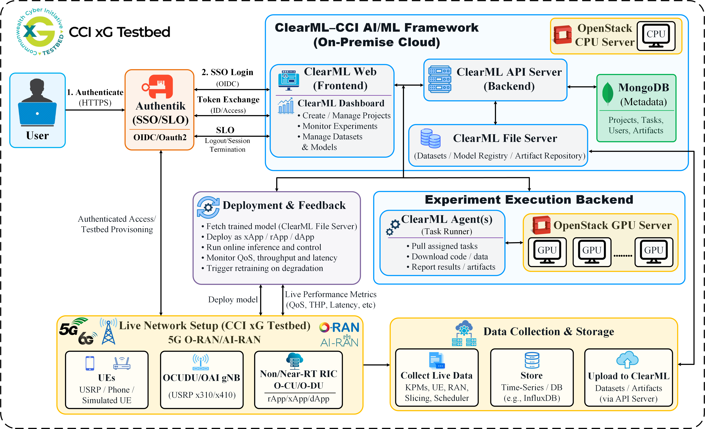
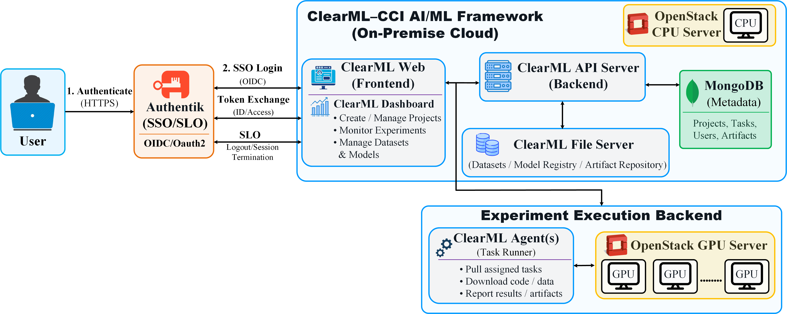
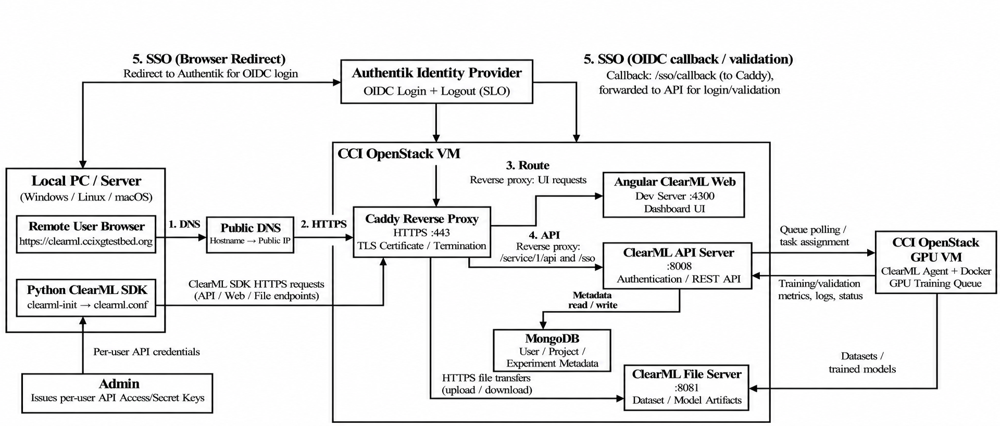

# CCI-ClearML: Multiuser AI/ML Framework Extension for the CCI xG Testbed

This repository presents an **integration and customization of the open-source ClearML Server and ClearML WebApp** for the **Commonwealth Cyber Initiative (CCI) xG Testbed at Virginia Tech**. Rather than deploying an isolated experiment tracker, the work adapts ClearML to serve as a shared AI/ML management layer for wireless-network research: authenticated researcher access, managed SDK credentials, project visibility, experiment tracking, GPU-worker orchestration, and a foundation for workflows driven by live testbed measurements.

> **Upstream attribution:** ClearML's experiment tracking, datasets and artifacts, API/File services, SDK, queues, and Agents are original ClearML capabilities. Authentik, CILogon, OpenStack, and the O-RAN testbed are existing platforms. This project contributes the **CCI-specific source modifications, authentication/authorization integration, and research-infrastructure deployment workflows** described below.

## 1. Project Overview

The CCI xG Testbed provides researchers and industry partners worldwide with remote access to a **full-stack wireless experimentation environment** through its publicly accessible OpenStack infrastructure, leveraging shared hardware resources, including USRPs, CPUs, and GPUs. This enables users to develop, deploy, and conduct experiments under realistic 5G O-RAN and AI-RAN network conditions without requiring dedicated local testbed hardware, while generating diverse measurement streams, including user equipment (UE) and radio metrics, key performance measurements (KPMs), scheduler statistics, network slicing indicators, throughput, and latency.

Developing **AI/ML-enabled intelligent network-control applications** from these observations requires repeatable dataset preparation, experiment execution on shared resources, model and version tracking, monitoring, and a means to evaluate trained models under changing network conditions. The ClearML–CCI extension provides a **centralized, multiuser AI/ML workspace** connected to the CCI xG Testbed infrastructure. ClearML management services run on an **OpenStack CPU-based compute instance**, while ClearML Agents can execute explicitly queued workloads on available **OpenStack GPU-accelerated compute instances**. Researchers use the customized WebApp and standard ClearML SDK to organize experiments and inspect permitted results. Authorized researchers access the customized ClearML WebApp using their existing Authentik-integrated testbed identities, without needing a separate ClearML browser login.

**The key distinction:** upstream ClearML provides general-purpose MLOps tools; the CCI development makes those tools usable in a **shared, identity-managed wireless research environment**, with customized account provisioning, administrative API-credential control, project-level visibility and authorization, and testbed-specific service routing.

## 2. Repository Structure

```text
clearml-cci-multiuser-AIML-framework-extension/
├── README.md
├── .gitignore
├── docs/
│   └── MODIFICATIONS.md
├── figures/
│   ├── clearml-cci-aiml-framework.png
│   ├── clearml-authentik-integration.png
│   └── clearml-network-flow-architecture.png
├── clearml-server/
│   ├── LICENSE
│   ├── README.md
│   ├── apiserver/
│   ├── fileserver/
│   └── docker/
└── clearml-web/
    ├── LICENSE
    ├── README.md
    ├── src/
    ├── angular.json
    └── package.json
```

`docs/MODIFICATIONS.md` distinguishes CCI-developed behavior from inherited ClearML functionality and identifies the principal backend, frontend, and configuration touchpoints. The researcher guide is planned as a separate document; browser/SDK credential setup is intentionally not duplicated here.

## 3. Why the Integrated Centralized AI/ML Framework Matters for a Live Network Testbed

- **From measurements to experiments:** Researchers can prepare datasets from live KPMs, UE/radio measurements, slicing indicators, throughput, and latency, then register datasets, experiments, and model artifacts in one shared environment. Network telemetry acquisition and preprocessing remain testbed-specific workflows.
- **Less local setup:** Researchers can submit explicitly queued training/validation tasks to configured ClearML Agents on shared GPU-accelerated compute instances instead of repeatedly preparing full training environments on individual machines. Dependencies and compatible workers still need to be configured.
- **Reproducible AI/ML lifecycle:** Centralized experiment settings, metrics, checkpoints, and comparisons help evaluate models across cells, traffic conditions, and network slices.
- **Monitoring and adaptation:** Performance measurements can inform model evaluation, retraining, and eventual deployment as xApps/rApps/dApps. Automated triggers and closed-loop control require additional integration and validation; they are not claimed as fully implemented here.
- **Safe collaboration:** Central identities, administrator-issued API credentials, and project-level visibility controls help researchers share approved results without granting unrestricted management access to other users.

## 4. End-to-End ClearML–CCI AI/ML Framework Architecture



*Figure 1. Testbed-oriented AI/ML lifecycle: existing live O-RAN/AI-RAN network resources, data collection and storage, ClearML-based management, GPU training, and a prospective deployment/monitoring/retraining feedback loop.*

Figure 1 depicts the customized ClearML platform within the wider **live network research cycle**, rather than depicting it as a stand-alone dashboard. The architecture connects **live O-RAN/AI-RAN equipment and software** to data collection, experiment registration, and model tracking. ClearML's WebApp, API Server, File Server, and MongoDB provide management and storage services on an OpenStack CPU-based compute instance; ClearML Agents can retrieve queued experiments and execute them on GPU-accelerated compute instances. The deployment-and-feedback path illustrates how trained models could be evaluated within network-control applications and retrained as traffic or QoS changes—not a claim of an already automated end-to-end closed loop.

## 5. Authentik Integration, User Identity, and Controlled Multiuser Access



*Figure 2. Identity-aware ClearML integration: Authentik-based browser access, customized ClearML services, MongoDB metadata, File Server, and GPU-side ClearML Agents.*

**Seamless access through existing testbed identities.** The CCI xG Testbed already has an identity-management system. Integrating ClearML through OIDC allows authorized researchers to use existing institutional/testbed identities instead of maintaining a separate ClearML browser login. Custom backend handlers provide SSO, just-in-time user provisioning, persistent issuer/subject identity linkage, and logout/session workflows. ClearML-only logout and Authentik-related SLO are distinct behaviors; session revocation coverage continues to be tested.

**Controlled API access for researchers and GPU agents.** Browser SSO does not automatically authorize the Python SDK or ClearML Agents. Customized credential-management APIs allow administrators to provision access/secret-key pairs for designated testbed users and ClearML worker agents while restricting ordinary users from independently creating or managing them. This supports deliberate onboarding and accountability for automated workloads.

**Protected collaboration and selective model sharing.** Different testbed research teams may work on unpublished algorithms or restricted measurements. The customized ClearML WebApp introduces **public/private project visibility controls**, supported by backend filtering and owner/administrator authorization checks for selected project operations. Publicly shared projects allow authorized testbed users to discover and reuse available approved datasets, models, and experimental results for comparative analysis or transfer-learning workflows without searching across separate platforms.

For concrete code changes and the tested scope of these controls, see [Modifications to Upstream ClearML](docs/MODIFICATIONS.md).

## 6. Network Architecture and Service Integration



*Figure 3. Network-level access and communication: public DNS, HTTPS and Caddy routing, OIDC callbacks, SDK API credentials, internal ClearML services, and remote GPU-worker traffic.*

Figure 3 explains how the shared service is made accessible while separating its public entry point from internal application services:

1. **Researcher access:** An authorized user visits `https://clearml.ccixgtestbed.org` from a browser. Public DNS points the hostname to the testbed's exposed endpoint.
2. **HTTPS and reverse proxy:** Caddy terminates TLS on port `443` and forwards requests to the appropriate service. In the illustrated development configuration, the Angular WebApp runs on port `4300`, the ClearML API Server on `8008`, and the File Server on `8081` behind the proxy.
3. **OIDC workflow:** Browser requests are redirected to the existing Authentik provider; the `/sso/callback` request returns through the public HTTPS endpoint to the customized backend for authentication validation and ClearML session establishment.
4. **Dashboard, API, and metadata:** The customized WebApp calls ClearML REST endpoints for user, project, and experiment operations. The API Server communicates with MongoDB and other underlying backend services as needed.
5. **Python SDK:** A researcher configures the existing ClearML Python SDK with service endpoints and **administrator-provisioned API credentials**. Browser cookies do not automatically authorize independent SDK clients.
6. **File transfers and execution:** Dataset/model/artifact traffic reaches the File Server through configured routes. An authorized ClearML Agent polls assigned queues and returns task execution results through the platform's interfaces.

The architecture provides a consistent external HTTPS entry point while retaining internal service separation. The shown ports, routes, and Angular development server describe the current integration environment; they should not be mistaken for an upstream production deployment recipe.

## 7. Testbed AI/ML Workflow: From Measurements to Models

The intended researcher-facing workflow is:

1. **Collect and prepare:** Capture relevant live network measurements through testbed-specific tools, preprocess them, and produce a versioned training/validation dataset.
2. **Register and organize:** Upload or register datasets and experiment information with ClearML; associate work with a project and select the appropriate visibility.
3. **Authenticate programmatic clients:** Use administrator-issued credentials to configure the ClearML SDK on a researcher machine or approved execution environment.
4. **Train and validate:** Track hyperparameters and metrics with the SDK; explicitly enqueue tasks when execution on a configured ClearML Agent/GPU worker is desired.
5. **Compare and retain:** Inspect training/validation performance, logs, model checkpoints, and artifacts through the shared dashboard.
6. **Share selectively:** Grant authorized collaborators access to approved projects/results or separately approved data/model resources. Use these to support comparisons, transfer-learning experiments, or independent validation.
7. **Evaluate for network use:** Where an appropriate downstream integration exists, test a model in an xApp/rApp/dApp or another network-control workflow, collect performance feedback, and determine whether retraining is required.

**Current implementation boundary:** The repository documents a deployed and actively tested ClearML integration, including browser SSO, JIT identity integration, administrator-controlled SDK credential operations, and project-level visibility/authorization modifications. Full automation of live ingestion, retraining decisions, and network deployment/feedback loops must be implemented and validated for the specific use case; this README does not claim they are already end-to-end operational.

## 8. CCI-Specific Extensions Compared with Upstream ClearML

|Testbed requirement|Upstream foundation|CCI customization or integration|
|-|-|-|
|Single research identity|ClearML login and authentication APIs|Authentik OIDC SSO, JIT provisioning, identity mapping, customized logout paths|
|Controlled programmatic access|ClearML API credentials and SDK|Administrator-controlled credential provisioning/management for researchers and Agents|
|Multiuser collaboration|ClearML projects and UI|Public/private project control, selected visibility filters and project-level write guards|
|Accessible service endpoints|ClearML Web, API and File services|Caddy HTTPS, OIDC callback routing, development WebApp proxy integration|
|Shared training infrastructure|ClearML queues and Agents|CCI OpenStack CPU management and GPU worker integration|
|Network-data research lifecycle|ClearML experiment, dataset and model tracking|Testbed-facing workflow for measured data, experiment reproducibility and prospective feedback/retraining pipelines|

The additions above **do not imply that ClearML's original dataset tracking, training queues, remote Agent, or model registry were newly invented by this project**. The detailed technical inventory, source touchpoints, and validation status are in [docs/MODIFICATIONS.md](docs/MODIFICATIONS.md).

## 9. Operational Status

The integrated ClearML service is **currently deployed and operational for authorized CCI xG Testbed users** and is undergoing active testing to discover defects, address integration issues, and improve functionality, reliability, and user experience.

The present documentation describes the framework architecture and reported implementation work. **Detailed documentation and evaluation** of authentication, authorization, and access-control mechanisms—including Authentik-integrated ClearML access, SDK-based remote access, and project creation and management—as well as automated AI/ML training and retraining pipelines and network-control deployment, are addressed separately within the CCI xG Testbed.

## 10. Licensing

This repository includes modified versions of two upstream projects with **different applicable licenses**. Original component license files and relevant copyright/third-party notices must be retained:

|Component|Upstream license|File|
|-|-|-|
|ClearML Server|Server Side Public License (SSPL) v1.0|[`clearml-server/LICENSE`](clearml-server/LICENSE)|
|ClearML WebApp|Apache License 2.0|[`clearml-web/LICENSE`](clearml-web/LICENSE)|

Additional upstream component notices, including applicable licenses under `clearml-server/apiserver/` and `clearml-server/fileserver/`, remain applicable. CCI-specific modifications derived from the upstream code are subject to the relevant upstream obligations. This repository does **not** declare a single new license covering all included code. Any separate licensing of independently developed contributions requires appropriate rights-holder authorization and compatibility with upstream terms.

## 11. References

* [ClearML Server — upstream source](https://github.com/clearml/clearml-server)
* [ClearML Web — upstream source](https://github.com/clearml/clearml-web)
* [ClearML Python SDK — upstream source](https://github.com/clearml/clearml)
* [ClearML Agent — upstream source](https://github.com/clearml/clearml-agent)
* [ClearML Architecture](https://clear.ml/docs/latest/docs/getting_started/architecture/)
* [ClearML Server Deployment](https://clear.ml/docs/latest/docs/deploying_clearml/clearml_server/)
* [ClearML Agent and Workers](https://clear.ml/docs/latest/docs/clearml_agent/)

## 12. Acknowledgments

We acknowledge **ClearML and its open-source contributors** for the Server, WebApp, Python SDK, File Server, experiment tracking, dataset/artifact management, task queueing, and Agent ecosystem used as the basis for this work.

The integration also relies on **existing Authentik, CILogon/institutional identity services, OpenStack infrastructure, and CCI xG Testbed network resources**. These underlying systems were not developed as part of this ClearML customization.

This independent research-oriented integration supports the Commonwealth Cyber Initiative (CCI) xG Testbed at Virginia Tech and is **not an official ClearML release or an endorsement by its upstream maintainers**.

